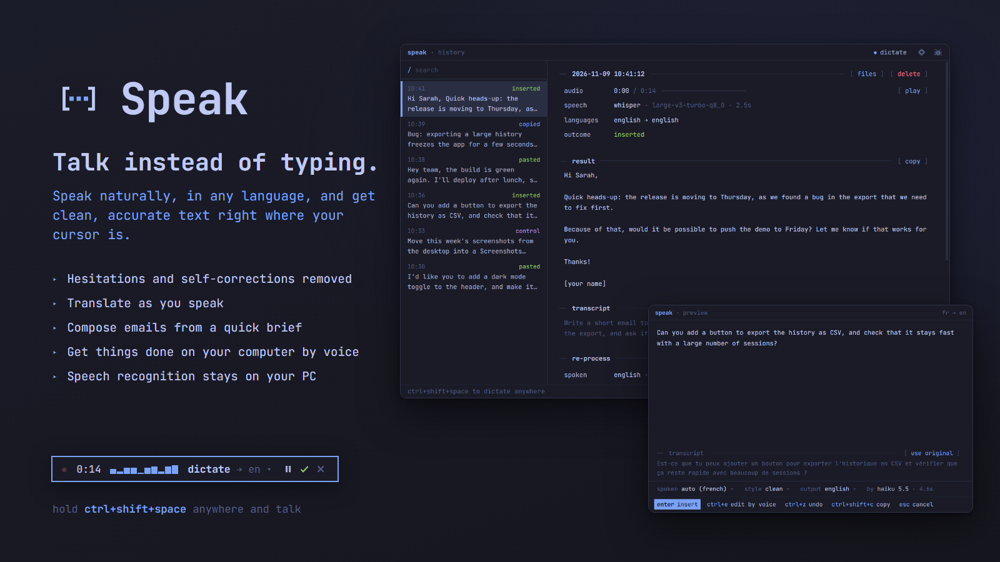
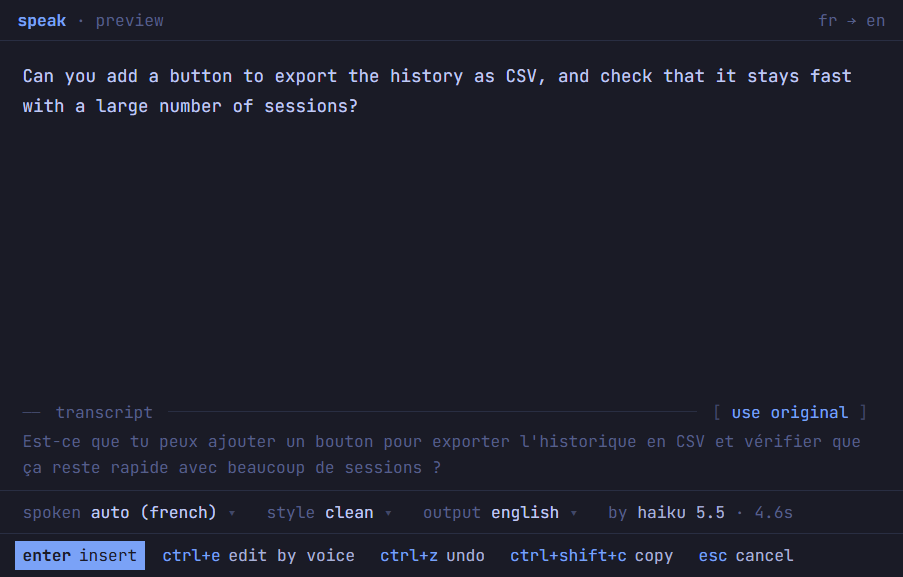

<p align="center">
  
</p>

<p align="center">
  <a href="https://github.com/rodolphebarbanneau/speak/releases/latest"><b>Download for Windows, macOS and Linux</b></a>
  &nbsp;·&nbsp; free and open source
</p>

# Speak

Speak turns your voice into clean, ready-to-send text in whatever app you're using. Press a shortcut, talk the way you normally do, with the "um"s, the pauses and the "no wait, I mean…", and Speak types what you meant, right where your cursor is.

It's made for people who write a lot: messages, emails, notes, and prompts for AI assistants like Claude Code, Codex or ChatGPT. Talking is about three times faster than typing.

## Why Speak

- **Works everywhere.** Any text field in any app: chat, email, documents, your code editor, an AI prompt box.
- **Writes what you meant.** Hesitations, repetitions and self-corrections disappear, and punctuation is fixed. "the sum, no sorry, the average" becomes "the average".
- **Speaks your language.** Dictate in English, French or dozens of other languages, and translate as you speak: talk in French, get English.
- **Writes for you.** In compose mode, describe what you need ("reply to this email, politely say no") and get the text written.
- **Acts for you.** In control mode, say what to do ("tidy my desktop", "reply to Marc that Thursday works") and the AI does it on your computer, asking first as you choose.
- **Private by design.** Speech recognition runs on your own computer. Your voice is never uploaded.
- **No new subscription.** The AI cleanup uses the Claude Code or Codex you already have, signed in with your own account. No API keys to manage.
- **Free and open source**, under the MIT license.

## How it works

1. Click into any text field.
2. Hold **Ctrl+Shift+Space** (**⌘⇧Space** on a Mac) and talk. Let go when you're done. You can also tap it once to start and again to stop.
3. Your text appears. Speak can paste it straight away, or show it to you first: change the format or the language, fix it by voice ("make it shorter"), then insert it.

Speak has three modes, each with its own shortcut: **dictate** writes what you said, **compose** writes what you ask for, and **control** does what you ask, on the computer.

While you talk, a small bar at the bottom of the screen shows the recording. Click the mode, the format, the languages, what happens then (preview or paste) or the context on it to change them, and use its buttons to pause, finish or cancel.

<p align="center">
  
</p>

### Compose

Plain dictation keeps your words. Even "write a function that…" is written down as that sentence, ready to send to an AI assistant, not carried out.

When you want Speak to _write_ something for you, add **Alt** to the shortcut: press **Ctrl+Shift+Alt+Space** (**⌘⇧⌥Space** on a Mac) instead and describe it, in any order and any language:

> Write a short email to Sarah. Tell her the release moves to Thursday because we found a bug in the export, and ask if we can push the demo to Friday. Keep it friendly.

Speak writes the email using only what you said. It doesn't invent facts or promises, keeps your doubts as doubts, and leaves a `[placeholder]` for anything missing, such as a name. To answer an email, copy it, then pick **clipboard** as the [context](#context) on the bar while you talk: Speak writes the reply in that email's language.

### Formats

| Format         | What you get                                                     |
| -------------- | ---------------------------------------------------------------- |
| **Clean**      | Your words, minus the hesitations and false starts. The default. |
| **Verbatim**   | Exactly what you said, with punctuation.                         |
| **Structured** | Organized into a clear message, with lists when it helps.        |
| **Summary**    | The key points, condensed.                                       |

Every dictation is saved in your history, with its recording, so you can find it again or redo it in another format or language.

### Context

Give Speak something to know what you're talking about: a **folder** on your computer, a **git repository** or a **web page** (an issue, a spec, documentation). Pick it on the bar while you talk (the last choice: your recent ones are listed; add a folder, or type or paste an address), or in **settings → context**. It stays until you change it.

- **When you dictate**, Speak only uses it to spell things right: file names, functions and terms as your project writes them ("the use auth hook" becomes `useAuth`). Nothing is added to what you said.
- **When you compose**, the AI can read the folder's files to write what you ask: "write the release notes for the export fix", "answer this issue".
- **The clipboard** is for one dictation only: copy the message you're replying to, then pick it on the bar.

Context is read-only. Speak and the AI never change anything in your folders: Claude Code gets only its file-reading tools, kept inside the folder, and Codex runs in its read-only sandbox. Git repositories and web pages are copied into `.speak/context`, and updated when you use them. Context isn't used by control mode, which acts on apps and the screen.

### Control

Press **Ctrl+Shift+Alt+Enter** (**⌘⇧⌥Enter** on a Mac) and say what to do: "reply to Marc's last email, tell him Thursday works", "put the PDFs of my desktop in a folder", "turn on dark mode in this app". A panel opens and stays on top. It shows what the AI says and does, asks for your approval, and lets you **pause**, **stop**, **restart** or **end** control. Keep talking to it with **Ctrl+Shift+Space** (**⌘⇧Space**), or type in it: while control is on, every Speak shortcut talks to it.

**What it may touch** (the scope, on the bar or the panel):

| Scope      | What the AI can do                                                                    |
| ---------- | ------------------------------------------------------------------------------------- |
| **app**    | Look at the app that was in front when you pressed the shortcut, click and type in it |
| **screen** | Any window: look, click, type, open apps. No files, no commands                       |
| **full**   | Everything: any window, any file, any command                                         |

Speak enforces the scope itself: the AI acts through Speak's tools, which refuse anything outside it. In the app scope, it asks you before it uses another app.

**When it asks first** (the approval): **every step**, **the plan** (you approve its plan once; it asks again for a risky step or one off the plan), **when risky** or **never**. Paying, passwords, deleting for good and sending messages as you always ask, unless you turn them off in **settings → control**. Answer in the panel, or by voice: "yes", "always" (the same kind of action in that app, until the session ends; never for paying or passwords), "no", or say what to do instead.

- **Keep working meanwhile.** It looks at windows without bringing them forward, and presses buttons, fills fields and scrolls in the background, even in a window behind yours or on another screen. What needs the real mouse or keyboard (clicking a point, typing into a document, a shortcut) waits until your hands have been still for a moment, acts, then gives them back: the pointer where it was, the focus to your window. Touch them meanwhile (a key, a click, the pointer) and that action stops at once; it then waits for you to say so before taking them again: **[continue]** in the panel, or "continue". **[go now]**, or "go", skips the wait.
- **It never types where you are.** It types only while the keyboard is on the window it acts on: if another window takes it, it stops. It never presses Enter in a text: long text, or text with line breaks, is pasted in one go (your clipboard is put back after), so a line break never sends a message; sending is its own step, which asks first.
- **The panel shows where it will act**: an approval comes with a picture of the spot, boxed, and the spot is boxed on the screen too when it's in sight.
- **Undo.** Files it moves, writes or trashes can be put back from the panel. Its trash is `.speak/control`.
- **Speak's panel stays out of its screenshots** (on Linux, it's blanked in them), and a frame shows when it has the mouse and the keyboard.
- What it looks at goes to your AI provider: an app scope sends only that app.
- **On Windows, macOS and Linux.** On a Mac, it asks first for **Accessibility** (to read the apps' buttons and fields, and to use the mouse and keyboard) and **Screen Recording** (to see their windows): **settings → control** shows both. Shortcuts there are ⌘ ones, and an app's menu bar counts as part of the app. On Linux, it needs an X11 session (Wayland doesn't let an app see or drive other apps' windows), and apps show their buttons and fields to it when the desktop's accessibility is on; without them, it works from what it sees.

## Get started

1. **Download** Speak for your system from the [latest release](https://github.com/rodolphebarbanneau/speak/releases/latest): the `.exe` installer for Windows, the `.dmg` for macOS (`arm64` for Apple Silicon, `x64` for Intel), or the `.AppImage` / `.deb` for Linux.
2. **Open it.** Speak lives in your system tray. On the first launch, a short guided setup opens:
   - **Speech recognition:** one click downloads it (about 1 GB, or 1.5 GB for the faster NVIDIA GPU version). It keeps downloading while you do the other steps.
   - **Microphone:** pick it and test it.
   - **AI provider:** Speak checks for Claude Code and Codex and picks the one that's ready. If neither is, it links to the install page and opens the sign-in in a terminal. Without one, Speak still types exactly what you said.
   - **Access (macOS):** allow the microphone, and accessibility so Speak can paste. For control mode, screen recording too.
   - **Try it:** your first dictation, in a box inside the setup.
3. **Talk.** Hold Ctrl+Shift+Space in any app.

Speak isn't code-signed yet, so on the first launch Windows shows "Windows protected your PC" (click **More info → Run anyway**), and macOS asks for confirmation (Control-click Speak in Applications, then **Open**; on macOS 15 or later, open it once, then click **Open Anyway** in **System Settings → Privacy & Security**).

Speak runs on any recent computer (on a Mac, macOS 13.5 or later). An NVIDIA graphics card or an Apple Silicon Mac makes transcription almost instant. Intel Macs transcribe on the processor.

## Shortcuts

| Action  | Windows and Linux    | macOS    |
| ------- | -------------------- | -------- |
| Dictate | Ctrl+Shift+Space     | ⌘⇧Space  |
| Compose | Ctrl+Shift+Alt+Space | ⌘⇧⌥Space |
| Control | Ctrl+Shift+Alt+Enter | ⌘⇧⌥Enter |
| Cancel  | Esc                  | Esc      |

Hold a shortcut while you speak, or tap it to start and again to stop. You can change all of them in **settings → general**, and turn a mode off there: its shortcut is then free for other apps, and the mode isn't offered on the bar or in the tray.

## Privacy

- **Your voice stays on your computer.** Recordings are transcribed locally and never uploaded.
- **Only text goes to the AI**, through your own Claude Code or Codex: the transcript and, when you choose a context, what Speak reads from it (an overview of the folder, the page, the clipboard), plus the files the AI reads when you compose. In control mode, the screenshots of what it acts on go too. Speak has no servers, no account and no analytics. Otherwise it only goes online to download the speech engine and model (GitHub, Hugging Face), to check for updates, and to fetch the git repositories and web pages you choose as context.
- **Your history is yours.** It's stored in a `.speak` folder in your home directory. Turn it off, or choose how long it's kept, in **settings → general**.

## Updates

Speak updates itself: new versions download in the background and install the next time you quit, or right away from the tray menu. You can turn this off in **settings → about**.

## Troubleshooting

**"No signal from …"**: your microphone is sending silence. This usually happens when the system's default input is a virtual device (Voicemod, Voicemeeter…). Pick your real microphone in **settings → speech → microphone** and use **test** to check it.

**The text isn't pasted in a game**: anti-cheat software such as FACEIT blocks simulated key presses while it runs. Speak notices, keeps your text on the clipboard and tells you to press **Ctrl+V** yourself.

**Recognition is off, or picks the wrong language**: in the preview or the history, pick the language you spoke under **spoken** to transcribe the recording again. To avoid it next time, set that language in **settings → speech → spoken** instead of auto-detect, and add names and jargon you use to **vocabulary**.

**macOS**: allow Speak in **System Settings → Privacy & Security** for the microphone, and for Accessibility so it can paste and detect when you release the shortcut. Control mode also needs Screen Recording (**Screen & System Audio Recording** on recent macOS); macOS may ask you to reopen Speak after you allow it.

**Linux on Wayland**: hold-to-talk isn't available, so tapping starts and stops, and control mode needs an X11 session (choose it when you log in). To paste, install `wtype` or `ydotool`. Your desktop can also bind a shortcut to `speak --toggle`. Speak runs through XWayland so the recording pill can stay above other windows without taking the focus; start it with `--ozone-platform=wayland` to run it natively instead (the pill may then open behind your windows).

**Something else**: click the bug at the top right of Speak's window (or **Report a bug…** in the tray menu) and say what happened. Your AI provider writes it up with Speak's diagnostics, and it opens as a filled-in issue on GitHub for you to read and submit. Nothing is sent until you do, and what Speak knows to be personal is taken out first; what you dictated is never included.

## For developers

<details>
<summary>Build from source, release process and how Speak works</summary>

### Build

```bash
npm install
npm run dev          # Electron with hot reload
npm run typecheck
npm run build        # bundle to out/
npm run dist         # installers (NSIS / DMG+ZIP / AppImage+deb)
npm run icons        # regenerate icons (scripts/generate-icons.mjs)
```

If you launch from inside another Electron app's terminal (T3 Code, VS Code…), unset `ELECTRON_RUN_AS_NODE` first.

### Release

Bump `version` in `package.json` and push a matching `v*` tag. `.github/workflows/release.yml` builds Windows, macOS for Apple Silicon and Intel (compiling universal whisper.cpp binaries via `scripts/build-whisper.sh`) and Linux, and uploads the installers and their update manifests to a draft GitHub release. Publishing the draft rolls the update out to every install. Code signing is optional (`CSC_LINK`, `APPLE_ID`… secrets). Unsigned macOS builds are signed ad hoc and can't update themselves.

Easter eggs: `src/themes/schedule.ts` lists when each seasonal theme shows: its holiday (a date, or a weekday of a month such as Thanksgiving's fourth Thursday of November), and how many days before and after it. Halloween and Thanksgiving show from 3 days before to the day after, Christmas from a week before to the day after, the new year from New Year's Eve to January 2. Dates are read from the clock of the computer Speak runs on. Themes come and go by themselves; a release is only needed to change them or the schedule. The build checks the schedule: each theme has a folder, every date is real, and no two themes show on the same day. A theme shows by default; clicking its logo, top left, turns it off until its next season, and **settings → general → easter eggs** turns them off for good. To try a theme out of season: `SPEAK_THEME=christmas npm run dev`.

To test an update without publishing, serve a newer build's `dist/` folder over HTTP and start a packaged build with `SPEAK_UPDATE_FEED=http://localhost:<port>/`.

### How it works

- **Speech recognition**: [whisper.cpp](https://github.com/ggml-org/whisper.cpp) with Whisper large-v3-turbo (CUDA on NVIDIA, Metal on Apple Silicon), or NVIDIA Parakeet v3, plus Silero voice detection. On Windows and Linux the engine is downloaded in the app; macOS release builds bundle it.
- **AI**: the user's own, unmodified CLI, run non-interactively without tools, plugins, MCP servers or project settings. Speak never reads or stores credentials.
  - Claude Code: `claude -p --model haiku --effort medium --system-prompt-file … --tools "" --setting-sources "" --strict-mcp-config --disable-slash-commands --no-session-persistence --output-format json`. Each mode has its model (settings → ai → models): by default haiku for dictate, sonnet for compose and control.
  - Codex: `codex exec -m gpt-6-luna -c model_reasoning_effort="medium" -c model_instructions_file="…" --ignore-user-config --ignore-rules --sandbox read-only --ephemeral --skip-git-repo-check -o … -`. By default gpt-6-luna for dictate, and the first model of Codex's catalog, its workhorse, for compose and control.
  - Control runs a live session: Claude Code with `--input-format stream-json --output-format stream-json --permission-prompt-tool stdio` (its permission prompts come to Speak), Codex through `codex app-server` (approvals as JSON-RPC requests; its own computer use, browser, plugins and the user's MCP servers turned off). Speak serves its tools (screen, undoable file changes, plan, questions) as an MCP server on 127.0.0.1 with a token, and checks the scope and the approval level in each one. The screen, through each system's own calls (koffi) and accessibility API (in a bridge process kept for the session, so a hung app never blocks Speak), with real input only once the user's hands are still (libuiohook), given back after:
    - Windows: window list and focus through Win32; windows pictured with `PrintWindow` (in the background), the display with `desktopCapturer` (Speak's windows excluded from capture); controls through UI Automation (invoke, toggle, select, expand, value, scroll), by a PowerShell bridge; input through `SendInput`.
    - macOS: window list through `CGWindowListCopyWindowInfo`; windows and the display pictured by the window server (`CGWindowListCreateImage`, the display without Speak's windows), else `desktopCapturer`; controls, the menu bar and open menus through Accessibility (AX: press, value, scroll bar, focus), by Electron run as Node; windows brought forward by the window server as window switchers do (SkyLight), else AX and `NSRunningApplication`; input through `CGEventPost`, keys found on the user's layout, its ⌘ keys for shortcuts (`UCKeyTranslate`).
    - Linux (X11): window list, focus and stacking through the window manager's EWMH hints (else the window tree); windows pictured with `desktopCapturer`; controls through AT-SPI, by Electron run as Node; input through XTEST, characters the layout lacks typed through a spare key lent to them.
- **Insertion**: the text goes on the clipboard and Speak sends the paste keystroke (Windows: `SendInput` with scan codes). The text stays on the clipboard so a manual Ctrl+V works if the app ignored it, unless **restore clipboard** is on. Compose reads the selection with Ctrl+Insert, which never interrupts a terminal.

### Command line

Flags are forwarded to the running instance, for desktop shortcuts (e.g. on Wayland) and scripts:

```
speak --toggle        start / stop dictation
speak --compose       start / stop a compose dictation
speak --control       start control (an order by voice), or talk to the session under way
speak --order="…"     give control a typed order (a new session on the app in front, or the one under way)
speak --cancel        cancel the current dictation
speak --show          open the main window
speak --file=x.wav    process an audio file as if dictated
```

### Data (`~/.speak`, or `SPEAK_HOME`)

| Path                                   | Content                                                                                |
| -------------------------------------- | -------------------------------------------------------------------------------------- |
| `config.json`                          | Settings                                                                               |
| `config.v1.json`                       | Settings as an older version saved them, before Speak moved them to the current layout |
| `history/YYYY-MM-DD/<id>/session.json` | Transcript, every version of the text, timings, the outcome                            |
| `history/YYYY-MM-DD/<id>/audio.wav`    | The recording (optional)                                                               |
| `models/`, `bin/`                      | Speech models and the whisper.cpp engine                                               |
| `control/<id>/`                        | Control's trash and the backups its undo restores                                      |
| `logs/speak.log`                       | Diagnostics                                                                            |

### Source layout

```
src/
  main/            Electron main process
    controller.ts  pipeline: record → transcribe → AI → preview or paste
    bug-report*.ts "report a bug": diagnostics, scrubbing, the AI's write-up
    hotkeys.ts     global shortcuts, hold-to-talk release detection
    stt/           whisper.cpp install and server, parakeet
    ai/            prompts, Claude Code and Codex CLIs
    control/       control mode: session, approvals, AI sessions, Speak's tools (MCP)
      screen/      the screen on each system: windows, pictures, input, accessibility bridges
    platform/      focus, paste, selection, keyboard, autostart, screen coordinates
  preload/         typed window.speak bridge
  renderer/src/    overlay (recording pill), preview dialog, main window, control panel
  shared/          types, constants, API contract
```

</details>

## License

[MIT](LICENSE)
