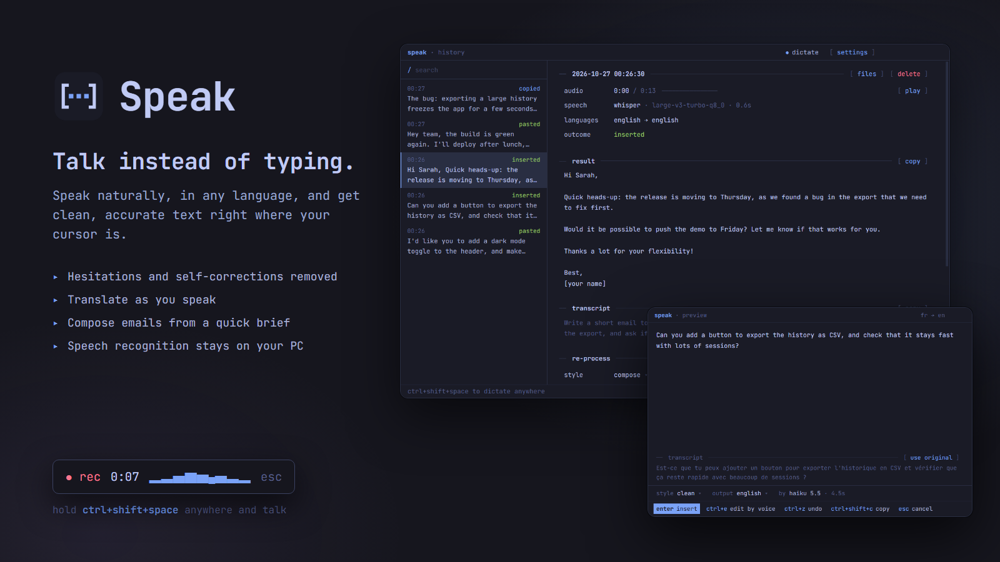
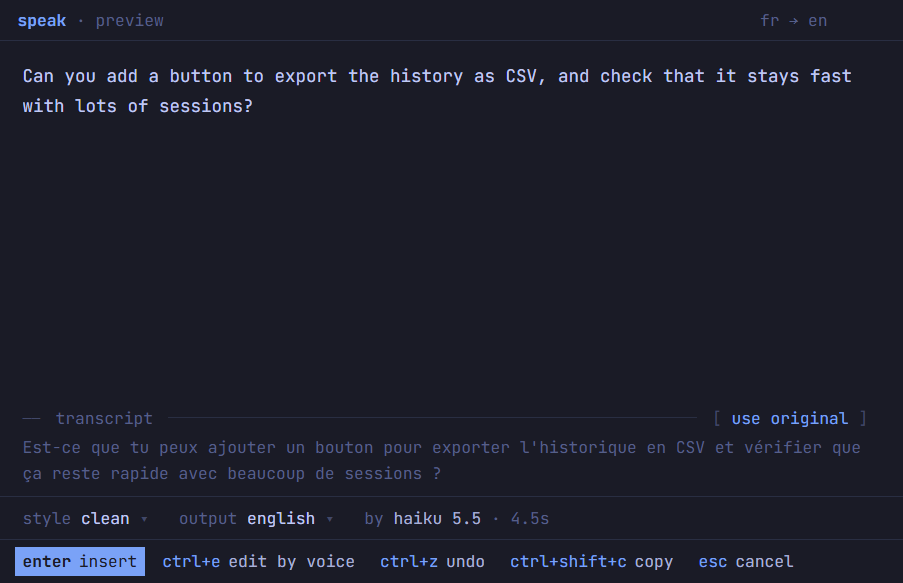

<p align="center">
  
</p>

<p align="center">
  <a href="https://github.com/rodolphebarbanneau/speak/releases/latest"><b>Download for Windows, macOS and Linux</b></a>
  &nbsp;·&nbsp; free and open source
</p>

# Speak

Speak turns your voice into clean, ready-to-send text in whatever app you're using. Press a shortcut, talk the way you normally do, with the "um"s, the pauses and the "no wait, I mean…", and Speak types what you meant, right where your cursor is.

It's made for people who write a lot: messages, emails, notes, and prompts for AI assistants like Claude Code, Codex or ChatGPT. Talking is about three times faster than typing.

## Why Speak

- **Works everywhere.** Any text field in any app: chat, email, documents, your code editor, an AI prompt box.
- **Writes what you meant.** Hesitations, repetitions and self-corrections disappear, and punctuation is fixed. "the sum, no sorry, the average" becomes "the average".
- **Speaks your language.** Dictate in English, French or dozens of other languages, and translate as you speak: talk in French, get English.
- **Writes for you.** In compose mode, describe what you need ("reply to this email, politely say no") and get the text written.
- **Private by design.** Speech recognition runs on your own computer. Your voice is never uploaded.
- **No new subscription.** The AI cleanup uses the Claude Code or Codex you already have, signed in with your own account. No API keys to manage.
- **Free and open source**, under the MIT license.

## How it works

1. Click into any text field.
2. Hold **Ctrl+Shift+Space** (**⌘⇧Space** on a Mac) and talk. Let go when you're done. You can also tap it once to start and again to stop.
3. Your text appears. Speak can paste it straight away, or show it to you first: change the style or the language, fix it by voice ("make it shorter"), then insert it.

<p align="center">
  
</p>

### Compose

Plain dictation keeps your words. Even "write a function that…" is written down as that sentence, ready to send to an AI assistant, not carried out.

When you want Speak to _write_ something for you, press **Ctrl+Alt+Space** (**⌘⇧⌥Space** on a Mac) instead and describe it, in any order and any language:

> Write a short email to Sarah. Tell her the release moves to Thursday because we found a bug in the export, and ask if we can push the demo to Friday. Keep it friendly.

Speak writes the email using only what you said. It doesn't invent facts or promises, keeps your doubts as doubts, and leaves a `[placeholder]` for anything missing, such as a name. If you've selected text, like the email you're answering, Speak uses it too, and writes the reply in that email's language.

### Styles

| Style          | What you get                                                     |
| -------------- | ---------------------------------------------------------------- |
| **Clean**      | Your words, minus the hesitations and false starts. The default. |
| **Verbatim**   | Exactly what you said, with punctuation.                         |
| **Structured** | Organized into a clear message, with lists when it helps.        |
| **Summary**    | The key points, condensed.                                       |

Every dictation is saved in your history, with its recording, so you can find it again or redo it in another style or language.

## Get started

1. **Download** Speak for your system from the [latest release](https://github.com/rodolphebarbanneau/speak/releases/latest): the `.exe` installer for Windows, the `.dmg` for macOS (Apple Silicon), or the `.AppImage` / `.deb` for Linux.
2. **Open it.** Speak lives in your system tray. On the first launch, click **set up speak**:
   - **Speech recognition:** one click downloads it (about 1 GB, or 1.5 GB for the faster NVIDIA GPU version).
   - **AI provider:** pick Claude Code or Codex. Speak shows whether it's installed and signed in. Without one, Speak still types exactly what you said.
3. **Talk.** Hold Ctrl+Shift+Space in any app.

Speak isn't code-signed yet, so on the first launch Windows shows "Windows protected your PC" (click **More info → Run anyway**), and macOS asks for confirmation (Control-click Speak in Applications, then **Open**).

Speak runs on any recent computer. An NVIDIA graphics card or an Apple Silicon Mac makes transcription almost instant.

## Shortcuts

| Action  | Windows and Linux | macOS    |
| ------- | ----------------- | -------- |
| Dictate | Ctrl+Shift+Space  | ⌘⇧Space  |
| Compose | Ctrl+Alt+Space    | ⌘⇧⌥Space |
| Cancel  | Esc               | Esc      |

Hold a shortcut while you speak, or tap it to start and again to stop. You can change all of them in **settings → general**.

## Privacy

- **Your voice stays on your computer.** Recordings are transcribed locally and never uploaded.
- **Only text goes to the AI**, through your own Claude Code or Codex: the transcript and, when you compose, the text you selected. Speak has no servers, no account and no analytics. Otherwise it only goes online to download the speech engine and model (GitHub, Hugging Face) and to check for updates.
- **Your history is yours.** It's stored in a `.speak` folder in your home directory. Turn it off, or choose how long it's kept, in **settings → general**.

## Updates

Speak updates itself: new versions download in the background and install the next time you quit, or right away from the tray menu. You can turn this off in **settings → about**.

## Troubleshooting

**"No signal from …"**: your microphone is sending silence. This usually happens when the system's default input is a virtual device (Voicemod, Voicemeeter…). Pick your real microphone in **settings → general → input** and use **test** to check it.

**The text isn't pasted in a game**: anti-cheat software such as FACEIT blocks simulated key presses while it runs. Speak notices, keeps your text on the clipboard and tells you to press **Ctrl+V** yourself.

**Recognition is off, or picks the wrong language**: set the language you speak in **settings → general → spoken** instead of auto-detect, and add names and jargon you use to **vocabulary**.

**macOS**: allow Speak in **System Settings → Privacy & Security** for the microphone, and for Accessibility so it can paste and detect when you release the shortcut.

**Linux on Wayland**: hold-to-talk isn't available, so tapping starts and stops. To paste, install `wtype` or `ydotool`. Your desktop can also bind a shortcut to `speak --toggle`.

## For developers

<details>
<summary>Build from source, release process and how Speak works</summary>

### Build

```bash
npm install
npm run dev          # Electron with hot reload
npm run typecheck
npm run build        # bundle to out/
npm run dist         # installers (NSIS / DMG+ZIP / AppImage+deb)
npm run icons        # regenerate icons (scripts/generate-icons.mjs)
```

If you launch from inside another Electron app's terminal (T3 Code, VS Code…), unset `ELECTRON_RUN_AS_NODE` first.

### Release

Bump `version` in `package.json` and push a matching `v*` tag. `.github/workflows/release.yml` builds Windows, macOS (compiling whisper.cpp with Metal via `scripts/build-whisper.sh`) and Linux, and uploads the installers and their update manifests to a draft GitHub release. Publishing the draft rolls the update out to every install. Code signing is optional (`CSC_LINK`, `APPLE_ID`… secrets). Unsigned macOS builds are signed ad hoc and can't update themselves.

To test an update without publishing, serve a newer build's `dist/` folder over HTTP and start a packaged build with `SPEAK_UPDATE_FEED=http://localhost:<port>/`.

### How it works

- **Speech recognition**: [whisper.cpp](https://github.com/ggml-org/whisper.cpp) with Whisper large-v3-turbo (CUDA on NVIDIA, Metal on Apple Silicon), or NVIDIA Parakeet v3, plus Silero voice detection. On Windows and Linux the engine is downloaded in the app; macOS release builds bundle it.
- **AI**: the user's own, unmodified CLI, run non-interactively without tools, plugins, MCP servers or project settings. Speak never reads or stores credentials.
  - Claude Code: `claude -p --model haiku --effort medium --system-prompt-file … --tools "" --setting-sources "" --strict-mcp-config --disable-slash-commands --no-session-persistence --output-format json`. Compose uses sonnet.
  - Codex: `codex exec -m gpt-6-luna -c model_reasoning_effort="medium" -c model_instructions_file="…" --ignore-user-config --ignore-rules --sandbox read-only --ephemeral --skip-git-repo-check -o … -`.
- **Insertion**: the text goes on the clipboard, Speak sends the paste keystroke (Windows: `SendInput` with scan codes) and restores the clipboard. Compose reads the selection with Ctrl+Insert, which never interrupts a terminal.

### Command line

Flags are forwarded to the running instance, for desktop shortcuts (e.g. on Wayland) and scripts:

```
speak --toggle        start / stop dictation
speak --compose       start / stop a compose dictation
speak --cancel        cancel the current dictation
speak --show          open the main window
speak --file=x.wav    process an audio file as if dictated
```

### Data (`~/.speak`, or `SPEAK_HOME`)

| Path                                   | Content                                                     |
| -------------------------------------- | ----------------------------------------------------------- |
| `config.json`                          | Settings                                                    |
| `history/YYYY-MM-DD/<id>/session.json` | Transcript, every version of the text, timings, the outcome |
| `history/YYYY-MM-DD/<id>/audio.wav`    | The recording (optional)                                    |
| `models/`, `bin/`                      | Speech models and the whisper.cpp engine                    |
| `logs/speak.log`                       | Diagnostics                                                 |

### Source layout

```
src/
  main/            Electron main process
    controller.ts  pipeline: record → transcribe → AI → preview or paste
    hotkeys.ts     global shortcuts, hold-to-talk release detection
    stt/           whisper.cpp install and server, parakeet
    ai/            prompts, Claude Code and Codex CLIs
    platform/      focus, paste, selection, keyboard, autostart
  preload/         typed window.speak bridge
  renderer/src/    overlay (recording pill), preview dialog, main window
  shared/          types, constants, API contract
```

</details>

## License

[MIT](LICENSE)
